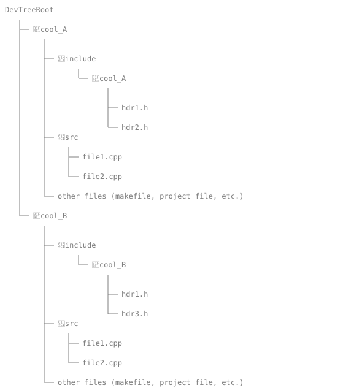
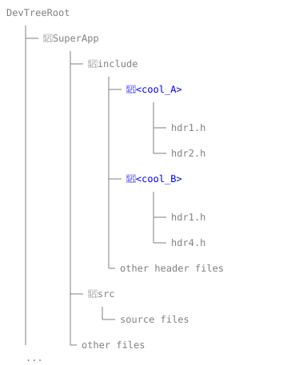
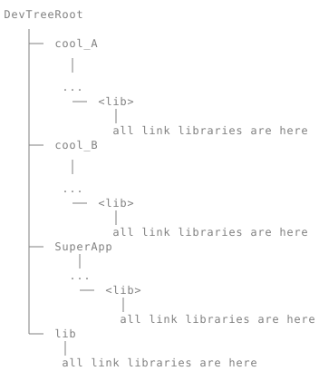
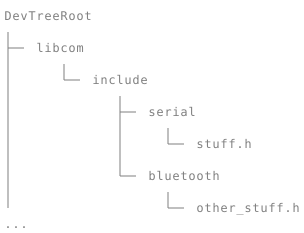
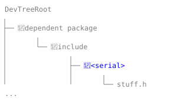
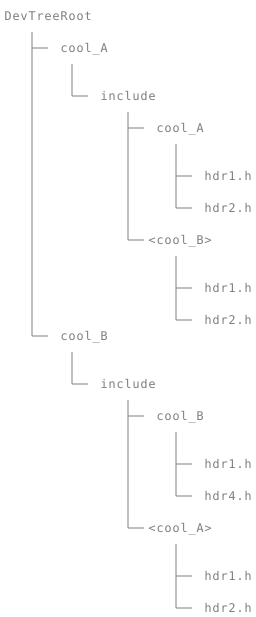
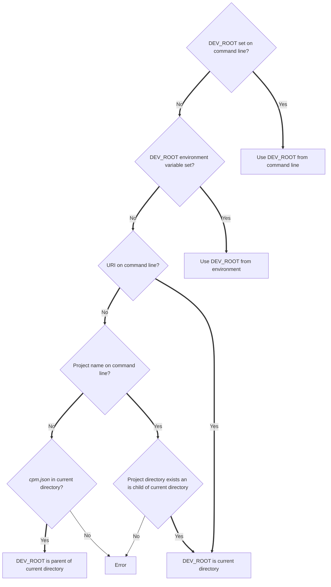

<h1> CPM - A C/C++ Package Manager </h1>

- [1. A Basic Example](#1-a-basic-example)
- [2. Code Layout Rules](#2-code-layout-rules)
  - [2.1. Multi-module library packages](#21-multi-module-library-packages)
- [Note that a library package with multiple modules still has only one binary `.lib` (or `.a`) file.](#note-that-a-library-package-with-multiple-modules-still-has-only-one-binary-lib-or-a-file)
  - [2.2. Weak Dependencies](#22-weak-dependencies)
  - [2.3. Compatibility with other code layout schemes](#23-compatibility-with-other-code-layout-schemes)
- [3. Installation](#3-installation)
- [4. Usage](#4-usage)
- [5. Semantics of CPM.JSON file](#5-semantics-of-cpmjson-file)
- [6. Operation](#6-operation)
  - [6.1 Clone/Fetch](#61-clonefetch)
  - [6.2 Create Symlinks](#62-create-symlinks)
  - [6.3 Build](#63-build)
  - [6.4 Post-build Commands](#64-post-build-commands)
- [7. Proving Ground](#7-proving-ground)
- [8. Integration with GitHub actions](#8-integration-with-github-actions)
- [9. Choosing DEV\_ROOT location](#9-choosing-dev_root-location)
     
CPM is a tool that helps coordinate work between multiple repositories. All you need is a simple JSON file to describe dependencies between repositories. This, together with the magic of symbolic links helps maintain a consistent environment for multiple libraries.

## 1. A Basic Example ##
You have two libraries `cool_A` and `cool_B` that need to be used in an application `super_app`. Both `cool_A` and `cool_B` use code from another library `utils`. Each one for these has its own Git repository.

You need to create a JSON file called `cpm.json` in each repository:

In `super_app`:
````JSON
{ "name": "super_app", "origin": "git@github.com:user/super_App.git",
  "depends": [
      {"name": "cool_A", "uri": "git@github.com:user/cool_A.git"},
      {"name": "cool_B", "uri": "git@github.com:user/cool_B.git"}
  ],
  "build" : [
      {"os": "windows", "command": "msbuild", "args": ["super_app.proj"]},
      {"os": "linux", "command": "cmake"}
  ]
}
````
In `cool_A`:
````JSON
{ "name": "cool_A", "origin": "git@github.com:user/cool_A.git",
  "depends": [
      {"name": "utils", "uri": "git@github.com:user/utils.git"},
  ],
  "build": [
      {"os": "windows", "command": "msbuild", "args": ["cool_a.proj"]},
      {"os": "linux", "command": "cmake"}
  ]
}
````

In `cool_B`:
````JSON
{ "name": "cool_B", "origin": "git@github.com:user/cool_B.git",
  "depends": [
      {"name": "utils", "uri": "git@github.com:user/utils.git"},
  ],
  "build": [
      {"os": "windows", "command": "msbuild", "args": ["cool_b.proj"]},
      {"os": "linux", "command": "cmake"}
  ]
}
````

In `utils`:
````JSON
{ "name": "utils", "origin": "git@github.com:user/utils.git",
  "build": [
      {"os": "windows", "command": "msbuild", "args": ["utils.proj"]},
      {"os": "linux", "command": "cmake"}
  ]
}
````

After that, you just have to fetch the `super_app` repository and invoke the CPM utility:
````
cpm super_app
````
It will take care of pulling all the other repositories and issuing the build commands for the current operating system.

## 2. Code Layout Rules ##
To be able to use this magic you have to adhere to a set of basic rules:
> **RULE 1** - Flat layout: each project has its own directory and all project directories are children of one common parent directory. The environment variable `DEV_ROOT` points to this root of development tree.

Here is a diagram showing the general code layout:


> **RULE 2** - Include files that need to be visible to users are placed in a sub-directory of the `include` directory with the same name as the library.

Users of `cool_A` can refer to `hdr1.h` file like this:
````C
#include <cool_A/hdr1.h>
````
An additional advantage of this organization is that it prevents name clashes between  different libraries. In this case, if a program uses both `cool_A` and `cool_B`, the corresponding include directives will be:
````C
#include <cool_A/hdr1.h>
#include <cool_B/hdr1.h>
````
<u>**Note:**</u> There is an enhancement to this rule: if the library package contains separate groups of files, they can be grouped together in *modules*. See below about multi-module libraries. Usually however, a library package has only one module.

> **RULE 3** - Include directories of dependent modules are made visible through symbolic links

In the structure shown before, the application that uses `cool_A` and `cool_B` will have an `include` directory, but in this directory there are _symbolic links_ to `cool_A` and `cool_B` include directories. The directory structure will look something like this (blue items in angle brackets denote symbolic links):



> **RULE 4** - All binary library packages reside in a `lib` directory at the root of development tree. Each package contains a _symbolic link_ to this directory.

Without repeating the parts already shown of the files layout, here is the part related to `lib` directory (again, blue items denote symbolic links):



If there are different flavors of link libraries (debug, release, 32-bit, 64-bit) they can be accommodated as sub-directories of the `lib` directory.

### 2.1. Multi-module library packages ###
Sometimes, a library may contain more than one group of files. For instance a communication library may contain a group of functions for serial communication, another for Bluetooth communication, and so on. We call these groups of files *modules*<sup>[1]</sup>. In this case, the header files can be divided in different directories, one for each module in the library:



 Inside the library, the headers can be referenced as:
```C++
#include <serial/stuff.h>
#include <bluetooth/other_stuff.h>
```
If a dependent package wants to include only one module of the library, it can use the `modules` attribute in the dependency descriptor.

Example:
````JSON
"depends": [
    {"name": "libcom", "modules": ["serial"], "origin": "git@github.com:user/mml.git"}]
````
This will produce the following directory structure (again, blue denotes symbolic links):  


It is OK to refer more than one module:
````JSON
  "depends": [
      {
        "name": "libcom",  
        "uri": "git@github.com:user/mml.git", 
        "modules": ["serial", "bluetooth"]
      }]
````

Note that a library package with multiple modules still has only one binary `.lib` (or `.a`) file.
---
<sup>1</sup> The word *module* is heavily overused in the software arena; adding one more use is not going to make much difference.

### 2.2. Weak Dependencies ###
Sometimes it may happen that two modules are interdependent. For instance `cool_A` needs a type definition that is provided by `cool_B`. Symbolic links can take care of this situation like shown below:



In such cases, CPM has to fetch the packages and create the symbolic links but should not initiate the build process of `cool_B` as part of the build process for `cool_A`. These situations are called *weak dependencies* and are flagged by the `fetchOnly` flag in the CPM.JSON file.

### 2.3. Compatibility with other code layout schemes ###
The layout required by CPM is simple and, as such, very compatible with other layout recommendations. My personal favorite is [The Pitchfork Layout](https://joholl.github.io/pitchfork-website/). Note however the following differences:
- PFL does not describe any mechanism for cooperation between different packages. The symbolic links mechanism described in this document is specific to CPM.
- PFL does not use a shared `lib/` directory. The PFL `libs/` directory is used for a different purpose.

## 3. Installation ##
CPM is written in Go. You can download a prebuilt version for [Windows](https://github.com/neacsum/cpm/releases/latest/download/cpm.exe) or [Ubuntu](https://github.com/neacsum/cpm/releases/latest/download/cpm). Alternatively, you can build it from source. To build it, you need to have the Go compiler [installed](https://go.dev/doc/install). Use the following command to build the executable:
````
go build cpm.go
````
There are no other dependencies and you just have to place the CPM executable somewhere on the path.

## 4. Usage ##
````
cpm [options] [package]
````
or
````
cpm version
````

If `package` is not specified, it is assumed to be in the current directory.

Valid options are:
  - `-b <branch_name>` branch name of root package
  - `-F` discards local changes when switching branches (issues a `git switch -f ...` command)
  - `-f` fetch-only (no build)
  - `-l` local-only (no pull)
  - `--root <dir>` or `-r <dir>` set root of development tree, overriding `DEV_ROOT` environment variable
  - `--uri <uri>` or `-u <uri>` URI for fetching root package
  - `--version` show program version
  - `-v` verbose
  - `--help` or `-h` show usage information


## 5. Semantics of CPM.JSON file ##
Following is a list of attributes that are recognized in the JSON file. Unknown attributes are silently ignored.
|Level | Attribute   | Value  | Semantics |
|------|-------------|--------|-----------|
| 1    | `name`      | string | Name of package |
| 1    | `origin`    | string | Download URI for the package |
| 1    | `build`     | array  | Commands to be issued for building the package. |
| 2    | `os`        | string | OS-es to which the build command applies <br/>(multiple OS-es are space-separated). Ex: `"windows"`, `"linux darwin"`, `"any"`|
| 2    | `command`   | string | Command issued for building the package |
| 2    | `args`      | array  | Command arguments |
| 1    | `depends`   | array  | Package dependencies |
| 2    | `name`      | string | Name of dependent package |
| 2    | `uri`       | string | URI for downloading dependent package |
| 2    | `branch`    | string | Git branch to use for dependent package |
| 2    | `modules`   | array  | Module names for packages with multiple modules |
| 2    | `fetchOnly` | bool   | Weak dependency (see [Weak Dependencies](#22-weak-dependencies)) |
| 2    | `post`      | array  | Post build commands (see below) |

## 6. Operation
If a package name has been specified on the command line, CPM looks for the directory `$DEV_ROOT/<package>`. If the directory does not exist, but an URI has been specified on the command line (the `--uri <uri>` option), it tries to fetch the top level package from the indicted URI. It then looks for the `CPM.JSON` file in the `$DEV_ROOT/<package>` directory and continues with the steps outlined below.

If no top level package has been specified on the command line, CPM assumes the current directory contains the top level package and proceeds to look for the `CPM.JSON` file.

### 6.1 Clone/Fetch
For each dependent package, CPM checks if the project directory exists under the `DEV_ROOT` tree. If not, it issues a `git clone` command to bring the latest version of the main branch or a specific branch if specified on the command line (the `-b` command line switch).

If the repository already exists, CPM issues a `git pull ...` or a `git switch ...` command to bring in the latest version of the main branch or the requested branch.

If CPM has been invoked with the `-l` command line switch, it skips this step.

### 6.2 Create Symlinks
CPM creates symlinks to include directories of all dependent packages and to the main `lib` directory. If the symlinks already exist, it verifies they point to proper target.

### 6.3 Build
The next step is to build each package by issuing the build commands appropriate for the OS environment. The `build` attribute contains an array of commands used to build the package. Each command has the following structure:
```JSON
{"os": "<windows|linux|any>", "cmd": "command name", "args": ["arg1", "arg2", ...]}
```
All commands that have an `os` attribute matching the current OS or without any `os` attribute are issued in order. Arguments that contain an environment variable using the syntax `${variable}` or `$variable` will be expanded.

If CPM has been invoked with the `-f` command line switch, it skips this step.

### 6.4 Post-build Commands
Each dependency descriptor may contain an array of commands to be executed after a dependent package was built. Commands have the same structure as the build commands.

If CPM has been invoked with the `-f` command line switch, it skips this step.

## 7. Proving Ground ##
CPM can be tested using a [sample project](https://github.com/neacsum/example_super_app). To use it, follow these steps:

<u>__For Windows__</u>

1. Make sure you have installed Visual Studio 2017 or higher (preferably VS2022).
2. Download [CPM](https://github.com/neacsum/cpm/releases/latest/download/cpm.exe) program and place it somewhere in the path
3. (Optional) Create a `devroot` directory:
````
c:\temp>mkdir devroot
c:\temp>set DEV_ROOT=c:temp\devroot
c:\temp>cd devroot
````
4. Run the CPM program:
````
c:\temp\devroot>cpm -u git@github.com:neacsum/example_super_app.git super_app
````
If all goes well, you should have a file `c:\temp\devroot\super_app\build\bin\x64\Debug\super_app.exe`. Also the directory `c:\temp\devroot\lib\x64\Debug` should contain the files
- `cool_A.lib`
- `cool_B.lib`
- `multi_mod.lib`

<u>__For Linux__</u>
1. Make sure you have a C/C++ compiler installed. If not, `sudo apt install build-essential` should take care of that.
2. Download [CPM](https://github.com/neacsum/cpm/releases/latest/download/cpm) program and place it somewhere in the path. This CPM program has no relation with the with the [Console Password Manager](https://github.com/comotion/cpm).
3. (Optional) Create a `devroot` directory:
````
$mkdir devroot
$export DEV_ROOT=devroot
$cd devroot
````
4. Run the CPM program:
````
$cpm -u git@github.com:neacsum/example_super_app.git super_app
````

## 8. Integration with GitHub actions ##
CPM can be integrated with GitHub actions. You only need to fetch the CPM program and run it. Below is an example pulled from the same proving ground application:
```yaml
name: Build
on:
  push:
    branches: [ "main" ]
  pull_request:
    branches: [ "main" ]

permissions:
  contents: read

env:
  # This is the destination directory for CPM tool
  USERPROFILE: .
  
jobs:
  build-win:
    runs-on: windows-latest

    steps:
      - name: Checkout code
        uses: actions/checkout@v5
        with:
          path: super_app
       
      - name: Get CPM
        uses: neacsum/configurator@v0.0.11
        with:
          name: cpm.exe
          url: https://github.com/neacsum/cpm/releases/latest/download/cpm.exe
     
      - name: Build
        run: cpm -v super_app
       
      - name: Run app
        shell: cmd
        run: .\super_app\build\x64\Release\super_app.exe

  build-linux:
    runs-on: ubuntu-latest

    steps:
      - name: Checkout code
        uses: actions/checkout@v5
        with:
          path: super_app

      - name: Get CPM
        uses: neacsum/configurator@v0.0.11
        with:
          name: cpm
          url: https://github.com/neacsum/cpm/releases/latest/download/cpm

      - name: Build
        run: cpm -v super_app

      - name: Run app
        run: 
          super_app/build/gcc/super_app
```
It uses an action to [fetch](https://github.com/marketplace/actions/engineerd-configurator) the CPM executable, clones the repo to be built and invokes CPM to build it.

## 9. Choosing DEV_ROOT location
As explained before, projects are laid out in a "flat" hierarchy of directories starting at `DEV_ROOT`. The `DEV_ROOT` directory can be specified either on command line (`-r` option) or through an environment variable.

If `DEV_ROOT` is not set on command line or as an environment variable, CPM tries to find a reasonable location:
- If the command line includes a URI for downloading the project (`-u` option), it assumes the current directory is going to be the root.
  
- If the command line includes a project name, and a directory with the same name exists and is a child of current directory, the current directory is going to be the root.
  
- If there is no project name or uri specified on command line, but in the current directory there is a file `cpm.json`, CPM assumes that current directory contains the project to build, and the parent of the current directory is the DEV_ROOT directory.

The following flowchart summarizes these steps.


